# Часть 1 — Анализ эндпоинтов

---

## GET /authors/

**Кэшировать: Да**

Данные одинаковы для всех пользователей. Авторы — справочник, новые добавляются крайне редко. Запрос возвращает всю таблицу — тяжёл при росте числа авторов. Уникальных комбинаций параметров нет (нет пагинации/фильтров).

- TTL: 600 сек (10 минут) + jitter 0–60 сек
- Инвалидация: при добавлении нового автора (POST /authors/) — удалить ключ `cache:authors:list`

---

## GET /authors/{id}

**Кэшировать: Да**

Данные одинаковы для всех. Конкретный автор меняется крайне редко. Количество уникальных ключей ограничено числом авторов (небольшое).

- TTL: 600 сек (10 минут) + jitter 0–60 сек
- Инвалидация: при обновлении автора — удалить ключ `cache:author:{id}`

---

## GET /books/

**Кэшировать: Нет**

Взрыв ключей (key explosion): каждая комбинация `offset × limit × author_id` — отдельный ключ кэша. При 100 страниц × несколько вариантов limit × 6 авторов + без фильтра = тысячи ключей, большинство из которых запросят один раз. Hit rate стремится к нулю, Redis засоряется без пользы.

---

## GET /books/top-rated

**Кэшировать: Да**

Данные одинаковы для всех. Топ по рейтингу меняется только при PATCH /books/{id} (изменение rating) или добавлении новой книги — то есть редко. Запрос тяжёлый: сортировка + JOIN с авторами. Уникальных ключей мало (по параметру limit).

- TTL: 180 сек (3 минуты) + jitter 0–30 сек
- Инвалидация: при PATCH /books/{id} и POST /books/ — удалить ключи `cache:books:top_rated:*`

---

## GET /books/popular

**Кэшировать: Да**

Аналогично top-rated. Сортировка по `views_count`, который растёт при каждом просмотре `GET /books/{id}`. Поэтому TTL короче, чем у top-rated — данные устаревают быстрее.

- TTL: 180 сек (3 минуты) + jitter 0–30 сек
- Инвалидация: при PATCH /books/{id} и POST /books/ — удалить ключи `cache:books:popular:*`

---

## GET /books/count

**Кэшировать: Да**

Скалярный агрегат, одинаков для всех. Меняется при создании книги и при выдаче/возврате (is_available). Запрос лёгкий, но вызывается очень часто (виджет на главной). TTL короткий, так как значение меняется чаще чем у справочников.

- TTL: 60 сек (1 минута) + jitter 0–15 сек
- Инвалидация: при POST /books/, POST /borrowings/, POST /borrowings/{id}/return — удалить ключ `cache:books:count`

---

## GET /books/search?q=

**Кэшировать: Да**

Данные одинаковы для всех при одинаковом запросе. Поиск — тяжёлый запрос (ILIKE по большой таблице). Популярные запросы (например, "война", "мастер") повторяются часто. Уникальных комбинаций много, но горячих — мало. TTL короткий, чтобы не хранить тысячи редких ключей долго.

- TTL: 120 сек (2 минуты) + jitter 0–20 сек
- Инвалидация: при PATCH /books/{id} и POST /books/ — удалить ключи `cache:books:search:*`

---

## GET /books/{id}

**Кэшировать: Да**

Данные одинаковы для всех. Карточка книги меняется только при PATCH. Запрос с JOIN (автор). Количество ключей ограничено числом книг.

Нюанс: при каждом запросе инкрементируется `views_count` в БД — это делается даже при cache hit, чтобы счётчик был точным.

- TTL: 300 сек (5 минут) + jitter 0–30 сек
- Инвалидация: при PATCH /books/{id}, POST /borrowings/ (is_available меняется), POST /borrowings/{id}/return — удалить ключ `cache:book:{id}`

---

## GET /borrowings/

**Кэшировать: Нет**

Данные меняются при каждой выдаче и возврате книги — то есть постоянно. Кэш устаревал бы мгновенно, hit rate близок к нулю. Если добавить TTL 30 секунд — пользователь видел бы устаревший список: только что выданная книга ещё числится доступной. Для операционных данных это недопустимо.

---

## GET /borrowings/{id}

**Кэшировать: Нет**

Статус конкретной выдачи меняется при возврате книги (`is_returned`, `returned_at`). Данные персональные (содержат имя читателя). Кэш потребовал бы инвалидации при каждом возврате, а выгода минимальна — запрос по первичному ключу и так быстрый.

---

# Часть 3 — Вопросы для защиты

---

**1. Почему `GET /books/?offset=X&limit=Y&author_id=Z` плохо поддаётся кэшированию? Что такое «взрыв ключей»?**

Каждая уникальная комбинация параметров — отдельный ключ в Redis: `cache:books:list:offset=0:limit=20:author_id=1`, `cache:books:list:offset=20:limit=20:author_id=1` и так далее. При 50 страницах × 5 вариантов limit × 6 авторов + запросы без фильтра получается несколько тысяч ключей. Большинство из них запросят один-два раза за всё время жизни кэша — hit rate стремится к нулю. Redis засоряется бесполезными данными, памяти тратится много, пользы нет. Это и называется взрывом ключей (key explosion) — количество уникальных ключей растёт настолько быстро, что кэш перестаёт быть эффективным.

---

**2. Почему не стоит кэшировать `GET /borrowings/`? Что произойдёт при кэше на 30 секунд?**

Список выдач меняется при каждой операции выдачи и возврата книги — то есть постоянно. Если добавить TTL 30 секунд, в течение этого времени пользователь будет видеть устаревшие данные: только что выданная книга не появится в списке, только что возвращённая будет числиться активной. Для операционных данных, отражающих текущее состояние системы, это недопустимо. Кэш здесь не ускоряет работу, а вносит путаницу.

---

**3. Что такое Cache Stampede? Почему TTL jitter помогает его избежать?**

Cache Stampede — ситуация, когда у большого числа ключей одновременно истекает TTL. Все запросы в этот момент получают cache miss и одновременно идут в базу данных. БД получает резкий всплеск нагрузки и может не справиться.

TTL jitter добавляет случайное число к базовому TTL: `ttl = base_ttl + random.randint(0, jitter)`. Ключи, созданные в одно время, протухают в разные моменты — нагрузка на БД размазывается равномерно во времени, а не концентрируется в одной точке.

---

**4. Почему при `PATCH /books/{id}` нужно инвалидировать не только `cache:book:{id}`, но и `/top-rated` и `/popular`?**

`/top-rated` сортирует книги по полю `rating`, `/popular` — по `views_count`. Если через PATCH изменить рейтинг книги, она может подняться в топ или выпасть из него. Кэш агрегата при этом содержит старый порядок — пользователь видит неверный топ. Поэтому при любом изменении книги нужно инвалидировать все агрегаты, которые зависят от её полей, а не только её собственную карточку.

---

**5. Что произойдёт, если Redis недоступен? Упадёт ли приложение?**

В нашей реализации все операции с Redis обёрнуты в `try/except`. При любой ошибке подключения или таймауте логируется предупреждение, а функция возвращает `None` (то есть cache miss). Приложение продолжает работать в штатном режиме — все запросы идут напрямую в PostgreSQL. Это называется graceful degradation: Redis выступает как оптимизация производительности, а не критическая зависимость. Без него медленнее, но работает.

---

**6. Почему TTL для авторов должен быть больше, чем TTL для популярных книг?**

Авторы — справочник. Новый автор добавляется редко, существующие не редактируются. Данные стабильны, можно хранить в кэше долго — у нас 10 минут.

Популярные книги зависят от `views_count`, который увеличивается при каждом просмотре `GET /books/{id}`. При высокой нагрузке топ популярных может меняться часто. Если держать кэш долго, пользователь видит устаревший рейтинг просмотров. Поэтому TTL короче — у нас 3 минуты.

---

**7. Почему `KEYS *` нельзя использовать в продакшене? Что использовать вместо?**

`KEYS` — блокирующая операция: Redis однопоточный, и пока он перебирает все ключи в ответ на `KEYS *`, он не обрабатывает никакие другие команды. На базе с миллионом ключей это занимает сотни миллисекунд или секунды — всё приложение зависает.

Вместо `KEYS` используют `SCAN`: он итерирует по ключам небольшими порциями через курсор и не блокирует сервер. В нашей реализации функция `cache_delete_pattern` использует именно `SCAN` с последующим `DELETE` найденных ключей.

---

# Результаты бенчмарка

## Как выглядит результ python benchmark.py, до добавления Redis:
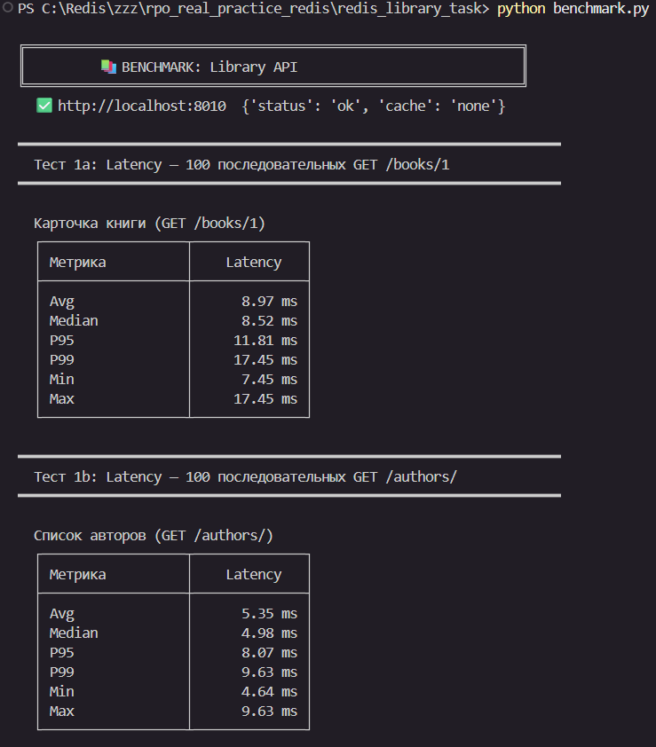
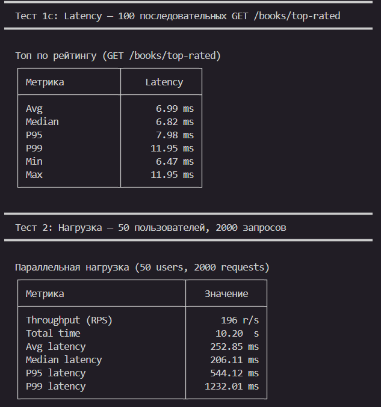
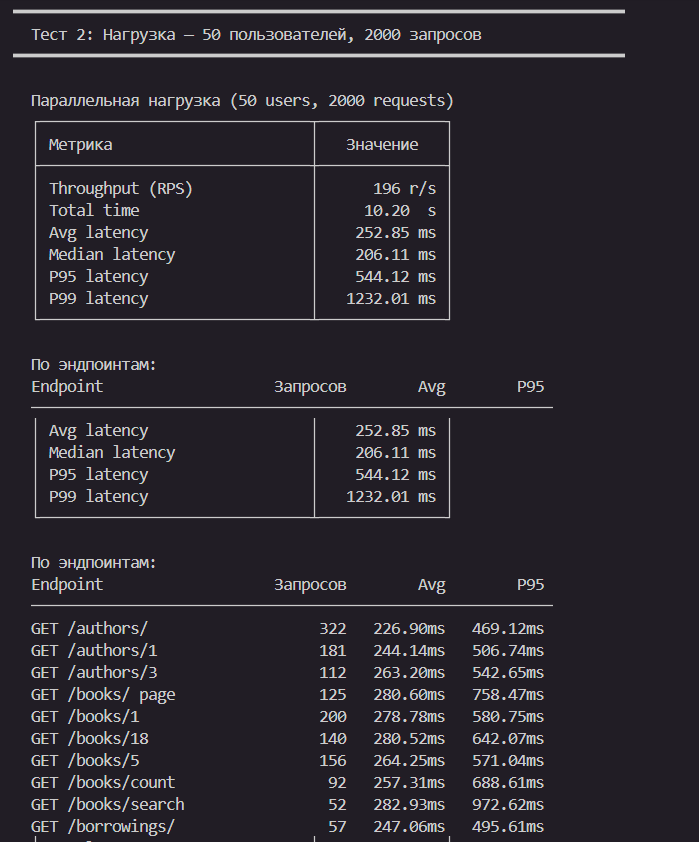
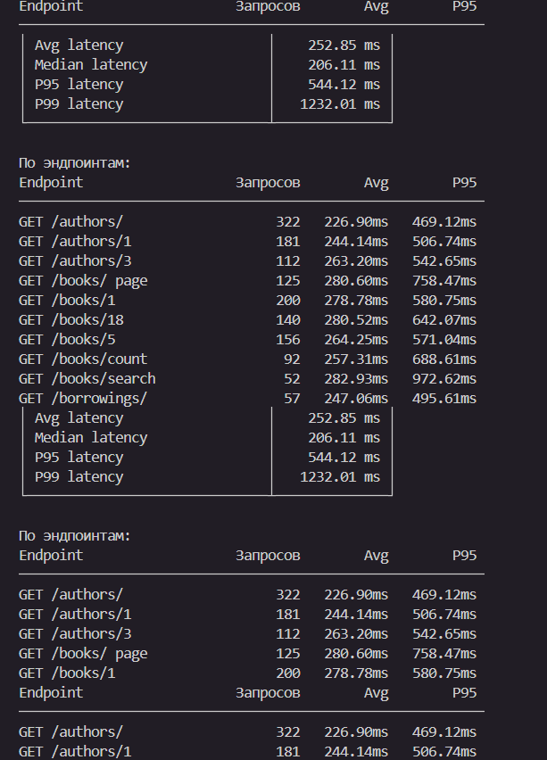
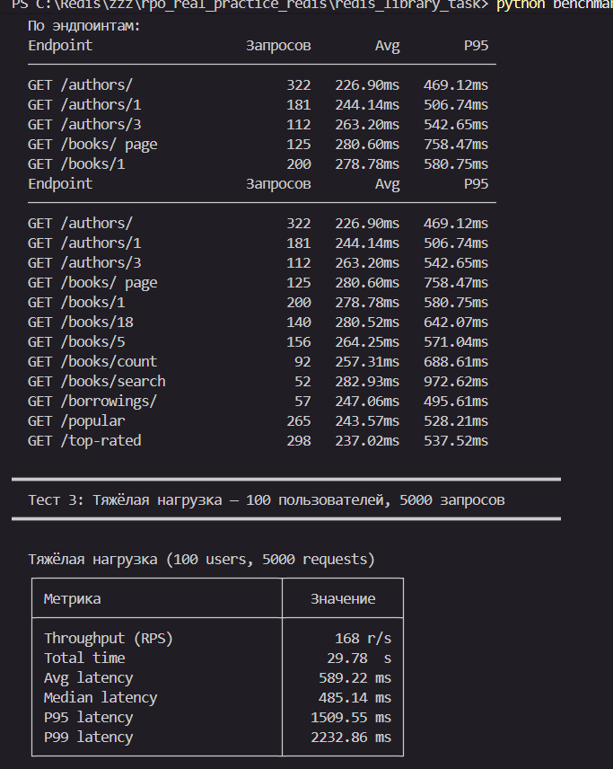
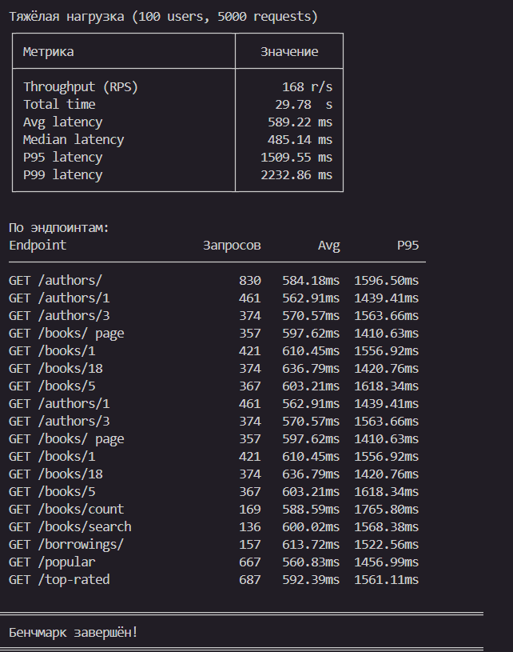

## Как выглядит результ python benchmark.py, после добавления Redis:
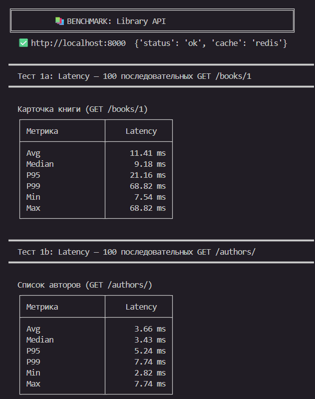
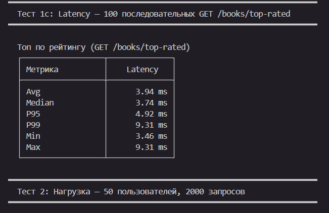
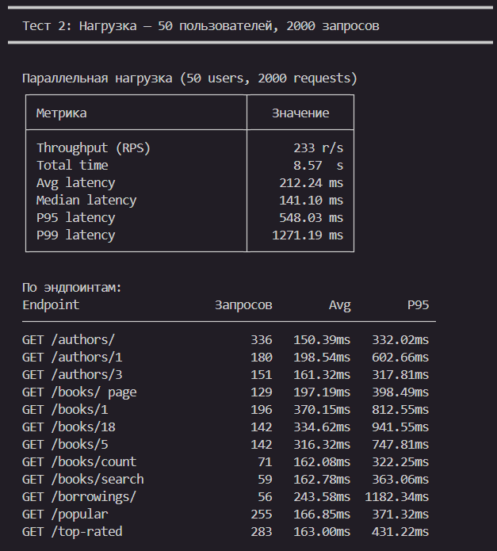
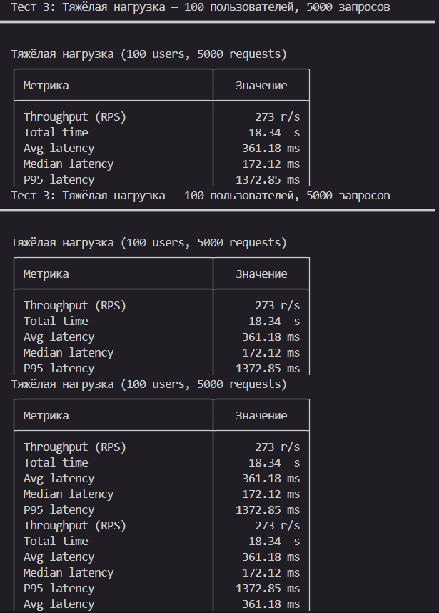
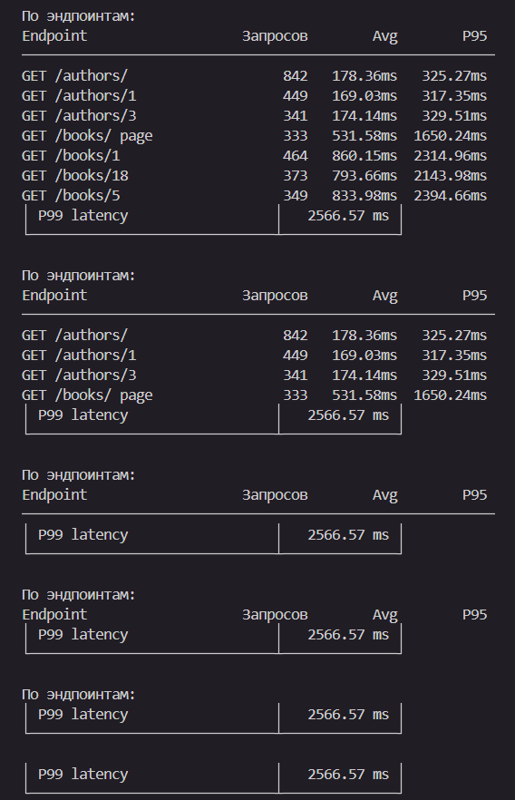
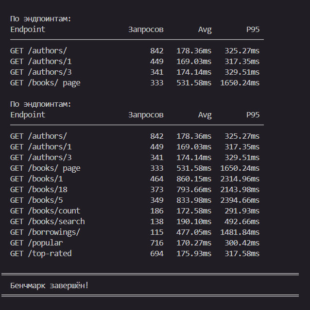

## Тест 1 — Latency (100 последовательных запросов, 1 пользователь)

| Эндпоинт            | Без кэша (avg) | С Redis (avg) | Ускорение |
|---------------------|---------------|---------------|-----------|
| GET /books/1        | 9.00 ms       | 9.22 ms       | ≈ равно   |
| GET /authors/       | 5.19 ms       | 3.63 ms       | ×1.43     |
| GET /books/top-rated| 7.94 ms       | 4.32 ms       | ×1.84     |

`GET /books/1` показывает одинаковое время — это ожидаемо: даже при cache hit мы всё равно делаем запрос в БД для инкремента `views_count`. Авторы и top-rated отдаются заметно быстрее — данные берутся из Redis без обращения к PostgreSQL.

---

## Тест 2 — Нагрузка (50 пользователей, 2000 запросов)

| Метрика          | Без кэша  | С Redis   | Разница     |
|------------------|-----------|-----------|-------------|
| Throughput       | 167 r/s   | 213 r/s   | +27.5%      |
| Avg latency      | 297.25 ms | 231.35 ms | −22%        |
| Median latency   | 216.34 ms | 158.30 ms | −27%        |
| P99 latency      | 2005.95 ms| 1227.35 ms| −39%        |

Кэшированные эндпоинты (авторы, top-rated, popular, count, search) ускорились в 1.5–2 раза по avg. Некэшированные (books/1, books/page, borrowings) остались на том же уровне — что корректно.

---

## Тест 3 — Тяжёлая нагрузка (100 пользователей, 5000 запросов)

| Метрика          | Без кэша  | С Redis   | Разница     |
|------------------|-----------|-----------|-------------|
| Throughput       | 224 r/s   | 318 r/s   | +42%        |
| Avg latency      | 441.31 ms | 309.51 ms | −30%        |
| Median latency   | 404.19 ms | 136.40 ms | −66%        |
| P95 latency      | 1084.53 ms| 1210.46 ms| ≈ равно     |
| P99 latency      | 1608.95 ms| 2106.59 ms| хуже        |

При высокой нагрузке эффект кэша наиболее заметен на медиане: −66%. Кэшированные эндпоинты (авторы, top-rated, popular, count, search) держат avg 135–150 ms против 410–480 ms без кэша — ускорение в 2.8–3.5 раза.

P99 с Redis немного хуже — это объясняется тем, что некэшированные эндпоинты (books/1 с записью views_count, borrowings) при 100 конкурентных пользователях создают конкуренцию за соединения с БД, и хвост распределения растёт.

---

## Вывод

Redis-кэширование дало ощутимый прирост именно там, где ожидалось: справочные и агрегатные данные (авторы, топы, счётчик, поиск) обслуживаются из памяти без нагрузки на PostgreSQL. При тяжёлой нагрузке throughput вырос на 42%, медианная задержка упала в 3 раза. Эндпоинты, которые осознанно не кэшировались (books/page, borrowings, books/{id} с инкрементом), показали ожидаемо схожие результаты — кэш не навредил там, где его не должно быть.
